<div align="center">

# ⚡ App Builder Agent
### *Interactive AI Web App Generator & In-Place Code Refiner*

<p align="center">
  <a href="https://app-builder-agent-zd50.onrender.com/">
    
  </a>
  
  
  
  
  
</p>

<p align="center">
  <b>Build entire web applications from plain English, preview them side-by-side in real-time, and iteratively refine code in-place through a persistent chat interface — just like Lovable.</b>
</p>

```
  📐 Planning  ───►  🏗️ Architecting  ───►  🔍 Searching  ───►  📖 Reading  ───►  ✍️ Coding  ───►  ✅ Completed
```

---

<p align="center">
  <a href="#-key-features">Key Features</a> •
  <a href="#-generation-lifecycle">Pipeline</a> •
  <a href="#-tech-stack">Tech Stack</a> •
  <a href="#-quick-start">Quick Start</a> •
  <a href="#-docker-deployment">Docker</a> •
  <a href="#-architecture">Architecture</a>
</p>

---

</div>

<br/>

## ✨ Key Features

<table>
  <tr>
    <td width="50%" valign="top">
      <h3>💬 In-Place Chat Editing</h3>
      <p>Modify existing project files directly without wiping and rebuilding from scratch. Tweak styles, fix bugs, add buttons, and enhance logic seamlessly with persistent history.</p>
    </td>
    <td width="50%" valign="top">
      <h3>👁️ Side-by-Side Live Preview</h3>
      <p>Interactive sandboxed iframe with automatic cache busting. Inspect changes the moment the agent finishes writing code.</p>
    </td>
  </tr>
  <tr>
    <td width="50%" valign="top">
      <h3>⚡ Multi-Agent Pipeline</h3>
      <p>Powered by LangGraph with specialized models: <b>Planner</b> (structure & design), <b>Architect</b> (dependency ordering), and <b>Coder</b> (production code generation).</p>
    </td>
    <td width="50%" valign="top">
      <h3>🕒 Automatic Version Rollbacks</h3>
      <p>Every initial generation and chat modification creates a snapshot. Roll back to any previous state with a single click.</p>
    </td>
  </tr>
  <tr>
    <td width="50%" valign="top">
      <h3>🛡️ Direct Markdown Fallback</h3>
      <p>Guaranteed resilient code extraction. If a model encounters JSON tool-call escaping limits, the engine automatically extracts code fences.</p>
    </td>
    <td width="50%" valign="top">
      <h3>📁 Git-Clean Isolated Storage</h3>
      <p>Zero repository clutter. All user generated code and version backups live in isolated, gitignored project directories.</p>
    </td>
  </tr>
</table>

<br/>

## 🔄 Generation Lifecycle

The agent streams fine-grained live updates over WebSockets so you can follow every step of creation:

```mermaid
flowchart LR
    A["📐 Planning<br/><b>Architecture & Files</b>"] --> B["🏗️ Architecting<br/><b>Task Breakdown</b>"]
    B --> C["🔍 Searching<br/><b>Locate Existing Files</b>"]
    C --> D["📖 Reading<br/><b>Inspect Context</b>"]
    D --> E["✍️ Coding<br/><b>Write File (x / y)</b>"]
    E --> F["✅ Completed<br/><b>Verify & Save</b>"]

    style A fill:#1e1b4b,stroke:#818cf8,stroke-width:2px,color:#fff
    style B fill:#1e293b,stroke:#60a5fa,stroke-width:2px,color:#fff
    style C fill:#27272a,stroke:#fde047,stroke-width:2px,color:#fff
    style D fill:#134e4a,stroke:#2dd4bf,stroke-width:2px,color:#fff
    style E fill:#312e81,stroke:#a5b4fc,stroke-width:2px,color:#fff
    style F fill:#064e3b,stroke:#4ade80,stroke-width:2px,color:#fff
```



| Phase | Icon | Role | Description |
| :--- | :---: | :--- | :--- |
| **Planning** | 📐 | `Planner` | Translates user prompt into data models, features, and file manifest |
| **Architecting** | 🏗️ | `Architect` | Sequences tasks in dependency order (HTML → CSS → JS) |
| **Searching** | 🔍 | `Scanner` | Checks active project workspace for existing code |
| **Reading** | 📖 | `Context` | Reads file content or flags file as new |
| **Coding** | ✍️ | `Coder` | Writes complete, production-ready code with live progress indicators |
| **Completed** | ✅ | `Verifier` | Validates file persistence and refreshes live preview |

<br/>

## 🛠️ Tech Stack

<div align="center">

| Layer | Technologies |
| :--- | :--- |
| **Frontend** | React 18 • Vite • CSS Glassmorphism • WebSockets |
| **Backend** | FastAPI • Uvicorn • Python AsyncIO • Pydantic v2 |
| **LLM Orchestration** | LangGraph • LangChain Core • Groq Cloud (`gpt-oss-120b`, `gpt-oss-20b`) |
| **Deployment** | Docker • Render • Cloudflare |

</div>

<br/>

## 📁 Architecture Overview

```
app-builder-agent/
├── 🤖 agent/
│   ├── graph.py        # LangGraph StateGraph (Planner → Architect → Coder)
│   ├── prompt.py       # Prompts for Planner, Architect, and Coder
│   ├── states.py       # Pydantic state schemas (Plan, TaskPlan, CoderState)
│   ├── tools.py        # Project file tools (read_file, write_file, safe paths)
│   └── parser.py       # Fallback direct markdown code fence extractor
├── 🚀 backend/
│   └── main.py         # FastAPI WebSocket streamer, Chat API, Static preview
├── 💻 frontend/
│   ├── src/
│   │   ├── components/
│   │   │   ├── ChatEditor.jsx      # In-place chat with localStorage history & badges
│   │   │   ├── PipelineStatus.jsx  # Lovable icon step bar with live pulse indicator
│   │   │   ├── PreviewPane.jsx     # Live sandbox iframe with cache-busting refresh
│   │   │   ├── ProjectSidebar.jsx  # Collapsible project drawer
│   │   │   ├── HistoryView.jsx     # Point-in-time version rollback viewer
│   │   │   ├── FileExplorer.jsx    # Project source tree & code inspector
│   │   │   ├── LogStream.jsx       # Color-coded live activity logs
│   │   │   └── PlanView.jsx        # Architecture specification viewer
│   │   └── App.jsx                 # Main 3-panel workspace interface
│   └── dist/                       # Compiled production frontend assets
├── 📦 storage/projects/ # User projects and snapshot versions (gitignored)
├── 🐳 Dockerfile       # Multi-stage production container build
└── ⚙️ render.yaml      # Render blueprint configuration
```

<br/>

## 🚀 Quick Start

### 1️⃣ Clone the Repository

```bash
git clone https://github.com/your-username/app-builder-agent.git
cd app-builder-agent
```

### 2️⃣ Configure Environment

Create a `.env` file in the root directory:

```env
GROQ_API_KEY=your_groq_api_key_here
PORT=8000
```

### 3️⃣ Backend Setup

```bash
# Create and activate virtual environment
python -m venv venv

# Windows
venv\Scripts\activate

# macOS / Linux
source venv/bin/activate

# Install dependencies
pip install -r requirements.txt
```

### 4️⃣ Frontend Build

```bash
cd frontend
npm install
npm run build
cd ..
```

### 5️⃣ Run the Application

```bash
python -m uvicorn backend.main:app --host 0.0.0.0 --port 8000 --reload
```

Navigate to **`http://localhost:8000`** in your browser.

<br/>

## 🐳 Docker Deployment

Run the complete multi-stage container locally or in production:

```bash
# Build Docker image
docker build -t app-builder-agent .

# Run container
docker run -p 8000:8000 -e GROQ_API_KEY="your_groq_api_key" app-builder-agent
```

<br/>

## 🤝 Contributing

Contributions, issues, and feature requests are welcome! Feel free to open an issue or submit a pull request.

<br/>

## 📄 License

This project is licensed under the **MIT License**.
