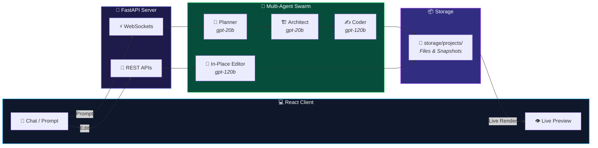

<div align="center">

# ⚡ Groky App-Builder Agents
### *Autonomous Multi-Agent AI Web Studio with In-Place Code Refinement*

<p align="center">
  
</p>

<p align="center">
  <a href="https://app-builder-agent-zd50.onrender.com/">
    
  </a>
  
  
  
  
</p>

<p align="center">
  <b>Groky</b> turns natural language prompts into live, production-ready web applications using a collaborative swarm of specialized AI agents. Preview changes instantly in an interactive sidecar sandbox, and refine existing code in-place with a persistent conversational copilot.
</p>

```
  ┌───────────────┐     ┌───────────────────┐     ┌────────────────┐     ┌────────────────┐
  │  📐 Planner   │ ──► │  🏗️ Architect    │ ──► │   ✍️ Coder     │ ──► │  💬 In-Place   │
  │     Agent     │     │      Agent        │     │     Agent      │     │  Editor Agent  │
  └───────────────┘     └───────────────────┘     └────────────────┘     └────────────────┘
```

---

<p align="center">
  <a href="#-the-4-specialized-agents">Agent Squad</a> •
  <a href="#-system-architecture">Architecture Design</a> •
  <a href="#-6-phase-generation-lifecycle">Lifecycle</a> •
  <a href="#-key-features">Features</a> •
  <a href="#-quick-start">Quick Start</a>
</p>

---

</div>

<br/>

## 🤖 The 4 Specialized Agents

Groky operates using **4 specialized agents** working in orchestration:

```
┌────────────────────────────────────────────────────────────────────────────────────────┐
│                                GROKY MULTI-AGENT SWARM                                 │
├─────────────────────┬──────────────────────┬────────────────────┬──────────────────────┤
│ 1. 📐 PLANNER AGENT │ 2. 🏗️ ARCHITECT AGENT│ 3. ✍️ CODER AGENT  │ 4. 💬 IN-PLACE COPILOT│
│ (gpt-oss-20b)       │ (gpt-oss-20b)        │ (gpt-oss-120b)     │ (gpt-oss-120b)       │
├─────────────────────┼──────────────────────┼────────────────────┼──────────────────────┤
│ • App Scope & Name  │ • Ordered Tasks      │ • Tool Call Writer │ • In-Place Updates   │
│ • Tech Stack Spec   │ • Dependency Graph   │ • Direct MD Fallback│ • Workspace Context │
│ • File Manifest     │ • File Contracts     │ • File-by-File Gen │ • Snapshot Auto-Save │
└─────────────────────┴──────────────────────┴────────────────────┴──────────────────────┘
```

| # | Agent | Model | Primary Mission |
| :-: | :--- | :--- | :--- |
| **1** | **📐 Planner Agent** | `openai/gpt-oss-20b` | Converts raw user prompts into complete software specifications: defines app name, core features, UI layout, tech stack, and required file paths. |
| **2** | **🏗️ Architect Agent** | `openai/gpt-oss-20b` | Takes the plan and performs topological dependency ordering (`HTML → CSS → JS`), drafting precise technical requirements for each file. |
| **3** | **✍️ Coder Agent** | `openai/gpt-oss-120b` | LangGraph React agent equipped with disk tools (`read_file`, `write_file`). Writes complete production code with an automatic markdown code fence extraction fallback. |
| **4** | **💬 In-Place Editor Agent** | `openai/gpt-oss-120b` | Interactive companion that refines existing code in-place upon user chat requests without regenerating or wiping the project. |

<br/>

## 🏛️ System Architecture Design



<br/>

## 🔄 6-Phase Generation Lifecycle

During generation, Groky broadcasts real-time phase updates over WebSockets:

```
┌─────────────┐     ┌──────────────┐     ┌─────────────┐     ┌─────────────┐     ┌─────────────┐     ┌───────────────┐
│ 📐 Planning │ ──► │ 🏗️ Architect │ ──► │  🔍 Search  │ ──► │   📖 Read   │ ──► │   ✍️ Code   │ ──► │ ✅ Completed  │
│  Structure  │     │   Ordering   │     │  Workspace  │     │   Context   │     │ File (x/y)  │     │   Verified    │
└─────────────┘     └──────────────┘     └─────────────┘     └─────────────┘     └─────────────┘     └───────────────┘
```

| Phase | Icon | Active Process |
| :--- | :---: | :--- |
| **1. Planning** | 📐 | Designing architectural blueprint, data flow, and file roster |
| **2. Architecting** | 🏗️ | Sequencing tasks topologically (`index.html` → `style.css` → `script.js`) |
| **3. Searching** | 🔍 | Searching project storage to inspect existing workspace state |
| **4. Reading** | 📖 | Reading file contents or detecting clean new file initialization |
| **5. Coding** | ✍️ | Implementing complete code file by file with live `(x / y)` counters |
| **6. Completed** | ✅ | Verifying file persistence, saving snapshot, and updating preview |

<br/>

## ✨ Key Features

<table>
  <tr>
    <td width="50%" valign="top">
      <h3>💬 In-Place Conversational Refinement</h3>
      <p>Modify existing code directly through chat (e.g. <i>"add a dark mode toggle"</i> or <i>"restyle buttons into a 4-column grid"</i>). Changes are applied in-place without rebuilding the app.</p>
    </td>
    <td width="50%" valign="top">
      <h3>👁️ Live Sandboxed Iframe Preview</h3>
      <p>Instant visual feedback with built-in cache busting. Your web app executes in a secure sandbox immediately upon completion.</p>
    </td>
  </tr>
  <tr>
    <td width="50%" valign="top">
      <h3>🕒 Automatic Version Rollbacks</h3>
      <p>Every initial build and subsequent chat modification automatically saves a restore point. Roll back to any prior version at any time.</p>
    </td>
    <td width="50%" valign="top">
      <h3>🛡️ Dual Tool + Direct Markdown Fallback</h3>
      <p>Resilient execution. If Groq encounters tool-call JSON escaping limits on large codebases, Groky instantly extracts markdown code blocks.</p>
    </td>
  </tr>
  <tr>
    <td width="50%" valign="top">
      <h3>📁 Git-Clean Storage</h3>
      <p>All generated applications and snapshots live inside <code>storage/projects/</code>, keeping the main repository clean.</p>
    </td>
    <td width="50%" valign="top">
      <h3>⚡ Zero-Cost Frictionless Deployment</h3>
      <p>No mandatory login barriers or database overhead. Deployable in a single lightweight Docker container on Render.</p>
    </td>
  </tr>
</table>

<br/>

## 🛠️ Tech Stack

<div align="center">

| Layer | Technologies |
| :--- | :--- |
| **Agents & Orchestration** | LangGraph • LangChain Core • Groq Cloud (`gpt-oss-120b`, `gpt-oss-20b`) |
| **Backend & Real-Time** | FastAPI • Uvicorn • WebSockets • Python AsyncIO • Pydantic v2 |
| **Frontend UI** | React 18 • Vite • Lucide & Emoji Icons • Glassmorphism CSS |
| **Infrastructure & CI/CD** | Docker Multi-Stage • Render Blueprint • Cloudflare CDN |

</div>

<br/>

## 🚀 Quick Start

### 1️⃣ Clone & Configure Environment

```bash
git clone https://github.com/your-username/app-builder-agent.git
cd app-builder-agent
```

Create `.env` in the root folder:

```env
GROQ_API_KEY=gsk_your_groq_api_key_here
PORT=8000
```

### 2️⃣ Backend Installation

```bash
# Create and activate virtual environment
python -m venv venv

# Windows:
venv\Scripts\activate

# macOS / Linux:
source venv/bin/activate

# Install requirements
pip install -r requirements.txt
```

### 3️⃣ Frontend Build

```bash
cd frontend
npm install
npm run build
cd ..
```

### 4️⃣ Launch Groky

```bash
python -m uvicorn backend.main:app --host 0.0.0.0 --port 8000 --reload
```

Open **`http://localhost:8000`** in your browser.

<br/>

## 🐳 Docker Deployment

Build and run Groky anywhere using the multi-stage Docker setup:

```bash
# Build production image
docker build -t groky-app-builder .

# Run container
docker run -p 8000:8000 -e GROQ_API_KEY="your_groq_api_key" groky-app-builder
```

<br/>

## 📄 License

Distributed under the **MIT License**. Free for personal and commercial use.
